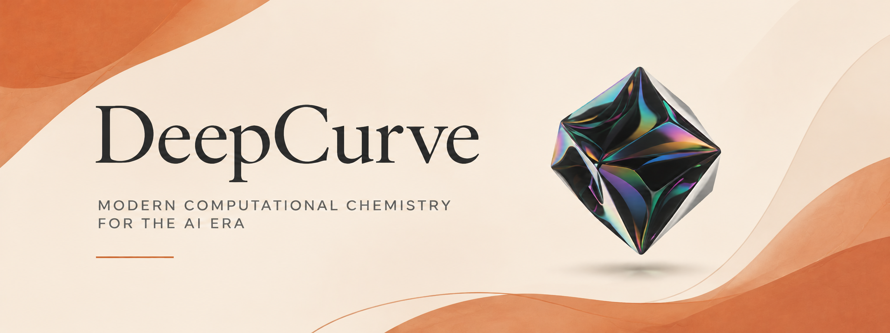
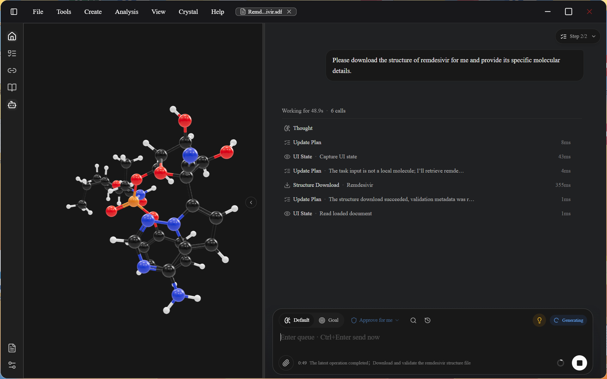
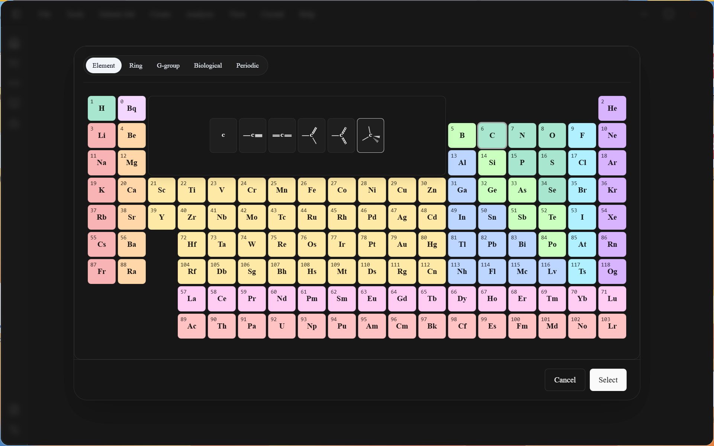
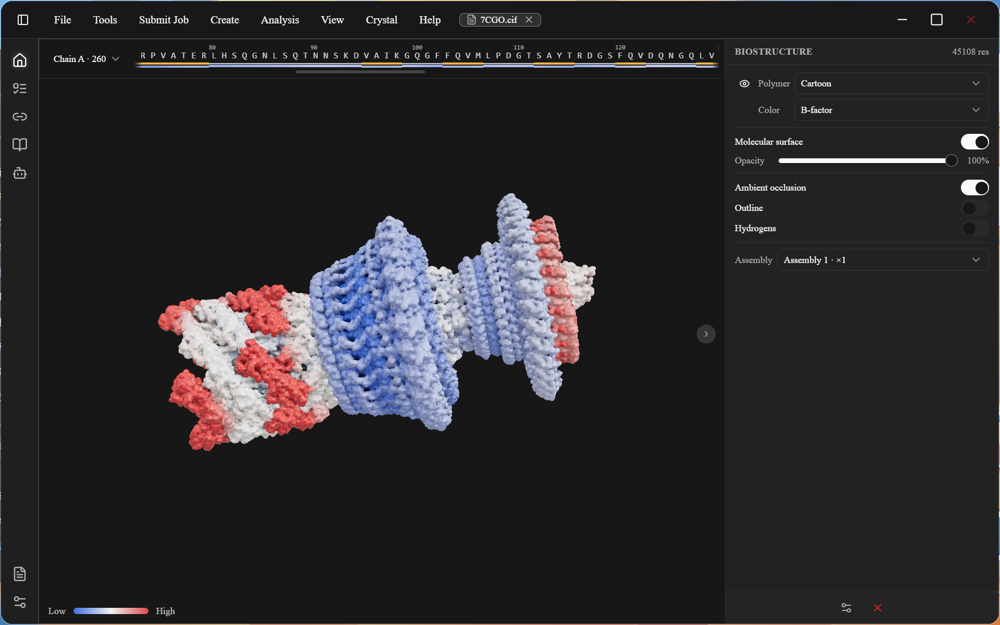
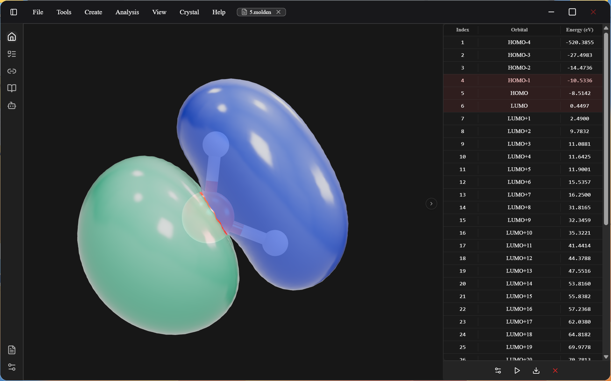

# DeepCurve

<div align="center">

**English** | [简体中文](README.zh-CN.md)

</div>

<p align="center">
  <a href="https://github.com/ruoguli/deepcurve/releases/latest"></a>
  <a href="https://github.com/ruoguli/deepcurve/releases"></a>
  
  <a href="LICENSE"></a>
</p>

<p align="center">
  
</p>
**DeepCurve** is a desktop application and computational chemistry middleware for the AI era. It connects researchers, AI Agents, scientific software and research data, bringing structure visualization, calculation analysis, input preparation and research workflows into one workspace.

<!-- release:version -->
Current version: **0.2.4** (2026-11-14).
<!-- /release:version -->

Builds are currently available only for Windows and Linux. The project can also support macOS, but the author does not currently have a Mac for testing, so no macOS build has been released. Email the author to obtain a macOS build and help report any potential issues.

<div align="center">

| Resource | Link |
| --- | --- |
| 🌐 Community | [chat.deepcurve.org](https://chat.deepcurve.org) |
| 💻 Project and releases | [github.com/ruoguli/deepcurve](https://github.com/ruoguli/deepcurve) |
| 👤 Author | Ruogu Li |

</div>

## 📥 Download

<!-- release:download -->
Latest version: **v0.2.4** — click a file to download it directly.

| 🪟 Windows (64-bit) | 🐧 Debian / Ubuntu | 🐧 Other Linux |
| :---: | :---: | :---: |
| [**deepcurve_0.2.4_x64-setup.exe**](https://github.com/ruoguli/deepcurve/releases/download/v0.2.4/deepcurve_0.2.4_x64-setup.exe) | [**deepcurve_0.2.4_amd64.deb**](https://github.com/ruoguli/deepcurve/releases/download/v0.2.4/deepcurve_0.2.4_amd64.deb) | [**deepcurve_0.2.4_amd64.AppImage**](https://github.com/ruoguli/deepcurve/releases/download/v0.2.4/deepcurve_0.2.4_amd64.AppImage) |

🔐 Checksums: [SHA256SUMS.txt](https://github.com/ruoguli/deepcurve/releases/download/v0.2.4/SHA256SUMS.txt) · Release notes and older versions: [Releases](https://github.com/ruoguli/deepcurve/releases)
<!-- /release:download -->

---

## 🔬 What DeepCurve is for

Calculations are handled by the solver; insights come from DeepCurve. Load structures, output files, wavefunctions and grid data in one click, view structures and orbitals in 3D, and use analysis panels to explore electronic structure, bonding, weak interactions and spectra. With structure building, input editing and job management, DeepCurve brings the workflow from preparation and execution through analysis into one research workspace.

## 🖼️ Screenshots

<p align="center">
  
  
</p>
<p align="center"><sub>Agent-assisted structure retrieval</sub> · <sub>Molecule builder</sub></p>

<p align="center">
  
  
</p>
<p align="center"><sub>Biomolecular structure view</sub> · <sub>Molecular orbital view</sub></p>

## ✨ Features

### 🧬 Molecular and crystal visualization

- View molecules, biomacromolecules and periodic crystals in ball-and-stick, stick or wireframe styles.
- Rotate, pan and measure structures; select atoms or connected fragments and edit atomic coordinates.
- Build molecules with the element picker and fragment library; edit lattice parameters and view periodic images.
- Display Miller-index planes, Brillouin zones and coordination polyhedra.
- Translate grid data and view it in supercells with the Crystal grid data tools.
- Render molecular orbitals, densities and mapped surfaces with adjustable isovalues, colors and materials, and export publication-quality images.

### 📈 Calculation results

- Parse outputs from ORCA, Gaussian and other programs; browse optimization steps and energy profiles, and animate vibrational modes.
- View and plot IR, Raman, UV-Vis, ECD, VCD and NMR spectra; what is available depends on the data contained in the source file.

### 🌀 Wavefunction analysis

DeepCurve runs wavefunction analyses in the background and presents results in dedicated panels and the 3D view. Available methods cover bonding, weak interactions, charges, electron localization, excited states, aromaticity, magnetic response and electronic structure. Each method has its own input requirements; the panel identifies missing data.

### 🛠️ Structure editing, export and workflows

- Create and edit input files for ORCA, CP2K, Quantum ESPRESSO and other programs.
- Export structures, images, 3D models and volumetric data for reports or for use in other scientific software.
- Preserve surface coloring when exporting 3D scenes as `.glb` / `.obj` for rendering in tools such as Blender.
- Submit and manage jobs on local WSL2/Linux, SSH/Linux hosts and Slurm clusters, which require the corresponding environment and accounts.
- Configure an Agent model service and connect external MCP tools that you explicitly set up, to assist with file handling and workflows.

### 📚 Literature and Agent workflows

- Store and read papers, add annotations and record notes in the sidebar Literature Library; the Agent can also interact with the library.
- View context usage and manually compress the Agent's context, and use the Agent to interact with more of DeepCurve's interface.
- Configure Memory and Token Usage Statistics in Settings, switch model providers, and discover available upstream models.
- Use built-in specifications for selected language models to help the Agent identify their capabilities.

## 📂 Supported file formats

DeepCurve reads molecular and crystal structures, calculation inputs and outputs, trajectories, orbital files and volumetric grids from a range of computational chemistry and materials programs, including ORCA, Gaussian, CP2K, Quantum ESPRESSO, ABACUS and VASP. Common formats such as XYZ, PDB, CIF and CUBE are also supported. Available data depend on the file and selected workflow; some analyses require companion files in the same calculation folder. File dialogs show the formats accepted by each action.

## 💿 Installation

Download the installer for your operating system from [GitHub Releases](https://github.com/ruoguli/deepcurve/releases):

| OS | Package | Notes |
| --- | --- | --- |
| Windows (64-bit) | `*-setup.exe` | Installs for the current user and does not require administrator rights. The installer appears in English or Simplified Chinese according to the Windows display language. DeepCurve uses Microsoft Edge WebView2, which ships with Windows 11; if it is missing, the installer downloads it from Microsoft, which requires an internet connection (installation stops if the download fails). |
| Linux (x86_64) | `.deb` / `.AppImage` | Install the `.deb` on Debian/Ubuntu-based systems; on other distributions, make the `.AppImage` executable and run it. |

On Debian / Ubuntu, run this command in the download folder:

```bash
sudo apt install ./deepcurve_0.2.4_amd64.deb
```

Then launch DeepCurve from the application menu or with the `deep-curve` command. For the AppImage, run:

```bash
chmod +x ./deepcurve_0.2.4_amd64.AppImage
./deepcurve_0.2.4_amd64.AppImage
```

If a platform has no package on the Releases page, no build is available for it in that version yet.

Starting with v0.2.2, new versions can be installed from **Check for updates** inside the app. Users of 0.2.0 and 0.2.1 need to download and install the current release manually once; subsequent versions will be offered in the app.

## 🚀 Getting started

1. Launch DeepCurve and load a structure, calculation output, wavefunction or volumetric file with **Open** or by drag and drop.
2. Choose an action from the menus or analysis panels. If the input does not provide what an analysis needs, the panel tells you which file or data type is required.
3. Review the results in the result panel and save them with the corresponding export function.

### 🖱️ 3D view controls

| Action | Effect |
| --- | --- |
| Left-drag | Rotate the view |
| Right-drag | Pan the view |
| `Ctrl` + left-drag | Move atoms in the structure |
| `Ctrl` + right-drag | Translate the structure |
| Double-click an atom | Select its connected fragment |

## 🤖 Agent, API keys and external programs

The Agent requires a model service and an API key; third-party model services may charge according to their own terms. API keys are stored in the operating system keychain and are never written to the settings file in plain text. The Agent can also search the web, either through the model provider's native search or through a built-in search tool.

DeepCurve does not replace computational engines such as ORCA, Gaussian or CP2K, and it does not bundle every optional external program. To run external programs or connect to remote hosts, provide the necessary software, accounts and credentials yourself. External MCP tools are only enabled after you configure them explicitly in Settings.

## 🆕 What's new

<!-- release:notes -->
Highlights of **v0.2.4**:

- Fixed `.cif` file reading and enabled Bio Mode for viewing biological structures such as DNA and proteins.
- Added hydrogen bonds to the bond-type selector in the right-side Bonds and Angles panel.
- Improved the Agent runtime and frontend interactions.
- Added VASP input-file generation to the Create module, including POSCAR, INCAR and KPOINTS, with optional POTCAR assembly from a user-provided pseudopotential library.
- Extended electron density difference (EDD) calculations to VASP density grids and electron-density CUBE files exported by CP2K, Quantum ESPRESSO (QE) and ABACUS. Both wavefunction and periodic-grid workflows support multiple references with an operation per reference, write CUBE results and can load them directly into the 3D view.
- Improved several 2D plotting interfaces, adding right-click options for exporting data and images and changing settings, and simplifying chart layouts.
- Added quick references for software listed under Inspirations in About.
- Filled gaps in method references and let the Agent retrieve the sources shown under View method source when needed.
- Added automatic movement of smaller surface fragments across periodic boundaries to join them to larger fragments in the display and reduce clipping near cell boundaries.

See the in-app release notes and the [Releases page](https://github.com/ruoguli/deepcurve/releases) for the full list of changes.
<!-- /release:notes -->

## 💬 Feedback and support

- Bug reports and feature requests: [GitHub Issues](https://github.com/ruoguli/deepcurve/issues)
- Discussion: [chat.deepcurve.org](https://chat.deepcurve.org)

When reporting a problem, please include the DeepCurve version, your operating system, steps to reproduce and, if possible, an example file you can share publicly.

## ⚠️ Limitations

Check analysis results against the original calculation settings and the scientific literature. DeepCurve cannot guarantee that every input file or analysis is appropriate for every research scenario; verify important results with dedicated programs or independent methods. Third-party components and their licenses can be viewed inside the application. If you use DeepCurve in research or publications, please cite DeepCurve. The author also recommends citing projects such as [Multiwfn](http://sobereva.com/multiwfn/), [PySCF](https://pyscf.org/) and [Mol*](https://molstar.org/); DeepCurve's implementation draws heavily on the practices of these excellent projects.

## 📄 License

DeepCurve is distributed under the [DeepCurve Software License Agreement](LICENSE). Third-party components are subject to their own licenses, which can be viewed in the application under **Help → About → Third-Party Components That Make Up DeepCurve**.
