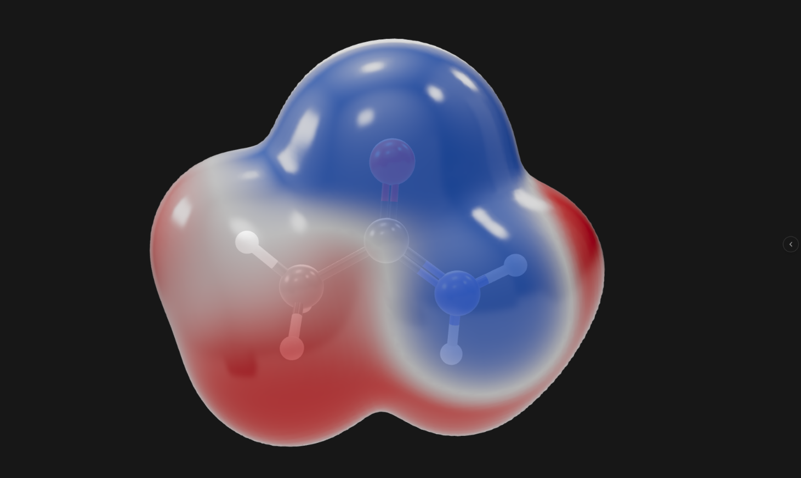

# DeepCurve

**English** | [简体中文](README.zh-CN.md)

  
  
  
  

  

**DeepCurve** is a desktop application for visualizing and analyzing results from computational chemistry and materials simulations. It brings molecular and crystal structure viewing, quantum chemistry output parsing, wavefunction analysis, structure editing, data export and job workflows together in a single application.

<!-- release:version -->
Current version: **0.2.2** (2026-10-27).
<!-- /release:version -->

DeepCurve is built with Tauri (Rust + React) and targets Windows and Linux. The project is at an early stage; the installers actually attached to the [Releases page](https://github.com/ruoguli/deepcurve/releases) are the authoritative list of supported platforms.

| Resource | Link |
| --- | --- |
| 🌐 Community | [chat.deepcurve.org](https://chat.deepcurve.org) |
| 💻 Source and releases | [github.com/ruoguli/deepcurve](https://github.com/ruoguli/deepcurve) |
| 👤 Author | Ruogu Li |

## 📥 Download

<!-- release:download -->
Latest version: **v0.2.2** — click a file to download it directly.

| 🪟 Windows (64-bit) | 🐧 Debian / Ubuntu | 🐧 Other Linux |
| :---: | :---: | :---: |
| [**deepcurve_0.2.2_x64-setup.exe**](https://github.com/ruoguli/deepcurve/releases/download/v0.2.2/deepcurve_0.2.2_x64-setup.exe) | [**deepcurve_0.2.2_amd64.deb**](https://github.com/ruoguli/deepcurve/releases/download/v0.2.2/deepcurve_0.2.2_amd64.deb) | [**deepcurve_0.2.2_amd64.AppImage**](https://github.com/ruoguli/deepcurve/releases/download/v0.2.2/deepcurve_0.2.2_amd64.AppImage) |

🔐 Checksums: [SHA256SUMS.txt](https://github.com/ruoguli/deepcurve/releases/download/v0.2.2/SHA256SUMS.txt) · Release notes and older versions: [Releases](https://github.com/ruoguli/deepcurve/releases) · Installation details: [Installation](#-installation)
<!-- /release:download -->

---

## 🔬 What DeepCurve is for

Quantum chemistry packages run the calculations; DeepCurve helps you inspect and analyze the data they produce. Open a structure, an output file, a wavefunction or volumetric data to examine geometries and orbitals in 3D, then use the analysis panels to study electronic structure, chemical bonding, weak interactions or spectra. DeepCurve also provides input file editing, structure building and job management, so that preparing, running and reviewing a calculation can happen in one place.

## ✨ Features

### 🧬 Molecular and crystal visualization

- View molecules, biomacromolecules and periodic crystals in ball-and-stick, stick or wireframe styles.
- Rotate, pan and measure structures; select atoms or connected fragments and edit atomic coordinates.
- Build molecules with the element picker and fragment library; edit lattice parameters and view periodic images.
- Display Miller-index planes, Brillouin zones and coordination polyhedra.
- Render molecular orbitals, densities and mapped surfaces with adjustable isovalues, colors and materials, and export publication-quality images.

### 📈 Calculation results

- Parse outputs from ORCA, Gaussian and other programs; browse optimization steps and energy profiles, and animate vibrational modes.
- View and plot IR, Raman, UV-Vis, ECD, VCD and NMR spectra; what is available depends on the data contained in the source file.

### 🌀 Wavefunction analysis

Wavefunction analyses run in the background and show their results in dedicated panels and in the 3D view.

| Category | Analyses |
| --- | --- |
| Bond orders | Mayer, Mulliken, Wiberg, Laplacian (LBO), fuzzy (FBO), IBSI, delocalization index (DI), multicenter bond order (MCBO), natural fragment bond orbitals (NFBO) |
| Weak interactions | NCI (RDG), IGM, IGMH interaction analysis, modified IGM (mIGM), IRI |
| Electron localization | ELF, LOL, density overlap regions indicator (DORI) |
| Atomic charges | Hirshfeld, ADCH, CM5 / 1.2×CM5, MBIS, VDD, Becke, Mulliken, Löwdin, SCPA, Stout–Politzer, Bickelhaupt; orbital populations |
| Surface properties and charges | Electrostatic potential (ESP) and local electron affinity energy (LEAE) on molecular surfaces with surface statistics and extrema, ESP-fitted charges (CHELPG/RESP), Hirshfeld surfaces with fingerprint plots |
| QTAIM | Critical point search and bond critical point properties; atomic basin charges, volumes and localization/delocalization indices |
| Conceptual DFT | Condensed Fukui functions, global reactivity indices, Fukui function grids |
| Aromaticity | HOMA / Bird indices with automatic ring detection |
| Excited states | Hole–electron analysis, natural transition orbitals (NTO), transition density matrix (TDM) heatmaps |
| Electronic structure | DOS / PDOS / COHP, VASP DOS and band structures, electron density difference (EDD) |
| Orbital localization and charges | Intrinsic atomic orbital (IAO) charges, intrinsic bond orbitals (IBO) |
| Magnetic response | Anisotropy of the induced current density (AICD), iso-chemical shielding surfaces (ICSS) |
| Information theory | Atomic and molecular Shannon entropy, Fisher information, Onicescu energy and Rényi entropy; information gain and other relative quantities; information-density grids |
| Molecular cavities | Isodensity-based cavity visualization and volumes |

Each analysis has its own input requirements. A file that only contains atomic coordinates is enough for structure viewing, but not for analyses that need a basis set, orbitals or electron density. If something is missing, the panel tells you which file or data is required.

### 🛠️ Structure editing, export and workflows

- Create and edit input files for ORCA, CP2K, Quantum ESPRESSO and other programs.
- Export structures, images, 3D models and volumetric data for reports or for use in other scientific software.
- Submit and manage jobs on local WSL2/Linux, SSH/Linux hosts and Slurm clusters, which require the corresponding environment and accounts.
- Configure an Agent model service and connect external MCP tools that you explicitly set up, to assist with file handling and workflows.

## 📂 Supported file formats

The table lists the formats DeepCurve can open and what it reads from each; ✅ marks information that is read. Formats without a program name are general formats. Calculation outputs (`.out` / `.log` / `.abo`) are identified by the program banner. File dialogs in the app offer the formats relevant to each action.

| Program | Format | Coordinates | Cell | MOs | Basis / GTF | Frames / trajectory | Optimization curve | Vibrational spectra | Electronic spectra | NMR | Grid | DOS / bands |
| --- | --- | :---: | :---: | :---: | :---: | :---: | :---: | :---: | :---: | :---: | :---: | :---: |
|  | `.xyz` | ✅ |  |  |  | ✅ |  |  |  |  |  |  |
|  | `.pdb` / `.ent` (`.gz`) | ✅ |  |  |  |  |  |  |  |  |  |  |
|  | `.pqr` | ✅ |  |  |  |  |  |  |  |  |  |  |
|  | `.mol` / `.sdf` | ✅ |  |  |  |  |  |  |  |  |  |  |
|  | `.mol2` | ✅ |  |  |  |  |  |  |  |  |  |  |
|  | `.cif` / `.mcif` | ✅ | ✅ |  |  |  |  |  |  |  |  |  |
|  | mmCIF / BinaryCIF (`.mmcif`, `.bcif`) | ✅ |  |  |  |  |  |  |  |  |  |  |
|  | `.molden` / `.input` | ✅ |  | ✅ | ✅ |  |  |  |  |  |  |  |
|  | `.wfn` | ✅ |  | ✅ | ✅ |  |  |  |  |  |  |  |
|  | `.wfx` | ✅ |  | ✅ | ✅ |  |  |  |  |  |  |  |
|  | `.cube` / `.cub` | ✅ |  |  |  |  |  |  |  |  | ✅ |  |
|  | OpenDX `.dx` |  |  |  |  |  |  |  |  |  | ✅ |  |
|  | VTK `.vti` |  |  |  |  |  |  |  |  |  | ✅ |  |
| ABACUS | `STRU` | ✅ | ✅ |  |  |  |  |  |  |  |  |  |
| ABINIT | `.abi` | ✅ | ✅ |  |  |  |  |  |  |  |  |  |
| ABINIT | `.abo` | ✅ | ✅ |  |  | ✅ | ✅ |  |  |  |  |  |
| ADF | `.run` | ✅ |  |  |  |  |  |  |  |  |  |  |
| ADF | `.out` | ✅ |  |  |  | ✅ | ✅ |  |  |  |  |  |
| AMBER | `.prmtop` / `.parm7` + `.rst7` / `.restrt` / `.inpcrd` | ✅ |  |  |  |  |  |  |  |  |  |  |
| AMBER | `.prmtop` / `.parm7` + `.mdcrd` | ✅ |  |  |  | ✅ |  |  |  |  |  |  |
| CASTEP | `.cell` | ✅ | ✅ |  |  |  |  |  |  |  |  |  |
| CASTEP | `.castep` | ✅ | ✅ |  |  | ✅ | ✅ |  |  |  |  |  |
| CP2K | `.inp` / `.restart` | ✅ | ✅ |  |  |  |  |  |  |  |  |  |
| CP2K | `.out` | ✅ | ✅ |  |  | ✅ | ✅ |  |  |  |  |  |
| CREST | `.energies` | ✅ |  |  |  | ✅ |  |  |  |  |  |  |
| CRYSTAL | `.d12` | ✅ | ✅ |  |  |  |  |  |  |  |  |  |
| CRYSTAL | `.out` | ✅ | ✅ |  |  | ✅ | ✅ |  |  |  |  |  |
| Dalton | `.dal` | ✅ |  |  |  |  |  |  |  |  |  |  |
| Dalton | `.out` | ✅ |  |  |  | ✅ | ✅ | ✅ |  |  |  |  |
| DFTB+ | `.gen` / `.hsd` | ✅ | ✅ |  |  |  |  |  |  |  |  |  |
| DFTB+ | `.out` | ✅ | ✅ |  |  |  |  |  |  |  |  |  |
| DMol3 | `.grd` |  |  |  |  |  |  |  |  |  | ✅ |  |
| FHI-aims | `.out` | ✅ |  |  |  | ✅ | ✅ |  |  |  |  |  |
| GAMESS-US | `.gms` | ✅ |  |  |  |  |  | ✅ | ✅ |  |  |  |
| Gaussian | `.gjf` / `.com` | ✅ |  |  |  |  |  |  |  |  |  |  |
| Gaussian | `.log` / `.out` | ✅ |  |  |  | ✅ | ✅ | ✅ | ✅ | ✅ |  |  |
| Gaussian | `.fch` / `.fchk` | ✅ |  | ✅ | ✅ |  |  |  |  |  |  |  |
| GROMACS | `.gro` | ✅ | ✅ |  |  |  |  |  |  |  |  |  |
| LAMMPS | `.data` | ✅ | ✅ |  |  |  |  |  |  |  |  |  |
| LAMMPS | `.dump` / `.lammpstrj` | ✅ | ✅ |  |  | ✅ |  |  |  |  |  |  |
| Molcas | `.out` | ✅ |  |  |  |  |  |  |  |  |  |  |
| Molpro | `.molpro` / `.molp` | ✅ |  |  |  |  |  |  |  |  |  |  |
| Molpro | `.out` | ✅ |  |  |  | ✅ | ✅ | ✅ |  |  |  |  |
| Molpro | `.xml` | ✅ |  | ✅ | ✅ |  |  |  |  |  |  |  |
| MOPAC | `.mop` | ✅ |  |  |  |  |  |  |  |  |  |  |
| Multiwfn | `.mwfn` | ✅ |  | ✅ | ✅ |  |  |  |  |  |  |  |
| NBO | `.31` | ✅ |  |  |  |  |  |  |  |  |  |  |
| NWChem | `.nw` | ✅ |  |  |  |  |  |  |  |  |  |  |
| NWChem | `.out` / `.nwout` | ✅ |  |  |  | ✅ | ✅ | ✅ | ✅ |  |  |  |
| OpenMX | `.out` | ✅ | ✅ |  |  | ✅ | ✅ |  |  |  |  |  |
| ORCA | `.inp` | ✅ |  |  |  |  |  |  |  |  |  |  |
| ORCA | `.out` | ✅ |  |  |  | ✅ | ✅ | ✅ | ✅ | ✅ |  |  |
| ORCA | `.hess` | ✅ |  |  |  |  |  | ✅ |  |  |  |  |
| ORCA | `.gbw` / `.uno` / `.unso` / `.uco` / `.qro` / `.loc` / `.nto` / `.mp2nat` / `.nat` | ✅ |  | ✅ | ✅ |  |  |  |  |  |  |  |
| ORCA | `.mkl` | ✅ |  | ✅ | ✅ |  |  |  |  |  |  |  |
| ORCA | orca_2json `.json` | ✅ |  | ✅ | ✅ |  |  |  |  |  |  |  |
| phonopy | `.yaml` | ✅ | ✅ |  |  |  |  |  |  |  |  |  |
| PSI4 | `.inp` | ✅ |  |  |  |  |  |  |  |  |  |  |
| Q-Chem | `.qcin` | ✅ |  |  |  |  |  |  |  |  |  |  |
| Q-Chem | `.out` / `.qcout` | ✅ |  |  |  | ✅ | ✅ | ✅ | ✅ |  |  |  |
| Qbics | `.inp` | ✅ |  |  |  |  |  |  |  |  |  |  |
| Qbics | `.out` | ✅ |  |  |  | ✅ | ✅ |  |  |  |  |  |
| Quantum ESPRESSO | `.in` | ✅ | ✅ |  |  |  |  |  |  |  |  |  |
| Quantum ESPRESSO | `.out` | ✅ | ✅ |  |  | ✅ | ✅ |  |  |  |  |  |
| SIESTA | `.fdf` / `.XV` | ✅ | ✅ |  |  |  |  |  |  |  |  |  |
| SIESTA | `.out` | ✅ | ✅ |  |  | ✅ | ✅ |  |  |  |  |  |
| SIESTA | `.ANI` | ✅ |  |  |  | ✅ |  |  |  |  |  |  |
| Turbomole | `control` / `coord` | ✅ |  |  |  |  |  |  |  |  |  |  |
| Turbomole | `.out` | ✅ |  |  |  | ✅ | ✅ | ✅ | ✅ |  |  |  |
| VASP | `POSCAR` / `CONTCAR` | ✅ | ✅ |  |  |  |  |  |  |  |  |  |
| VASP | `OUTCAR` | ✅ | ✅ |  |  | ✅ | ✅ | ✅ |  |  |  |  |
| VASP | `vasprun.xml` | ✅ | ✅ |  |  | ✅ | ✅ |  |  |  |  | ✅ |
| VASP | `XDATCAR` | ✅ | ✅ |  |  | ✅ | ✅ |  |  |  |  |  |
| VASP | `DOSCAR` / `EIGENVAL` / `PROCAR` |  |  |  |  |  |  |  |  |  |  | ✅ |
| VASP | `CHGCAR` / `CHG` / `ELFCAR` / `LOCPOT` | ✅ | ✅ |  |  |  |  |  |  |  | ✅ |  |
| XMVB | `.xmi` / `.xmo` | ✅ |  |  |  |  |  |  |  |  |  |  |
| xTB | `.out` | ✅ |  |  |  | ✅ | ✅ | ✅ |  |  |  |  |

- Turbomole and xTB vibrational spectra are read from the `vibspectrum` file in the same folder; VASP `OUTCAR` gives frequencies and modes without IR intensities.
- VASP `DOSCAR` / `EIGENVAL` / `PROCAR` are read from a calculation folder through the VASP DOS and band structure dialog.
- ORCA binary orbital files and `.mkl` open as a Molden file written beside them. Molecular orbitals of an output file come from a same-name wavefunction file (`.fch`, `.molden`, ...) in the same folder.
- AMBER coordinate and trajectory files take element and atom information from a topology file (`.prmtop` / `.parm7`) in the same folder.
- DeepCurve documents (`.qc`) can also be opened.

## 💿 Installation

Download the installer for your operating system from [GitHub Releases](https://github.com/ruoguli/deepcurve/releases):

| OS | Package | Notes |
| --- | --- | --- |
| Windows (64-bit) | `*-setup.exe` | Installs for the current user and does not require administrator rights. The installer appears in English or Simplified Chinese according to the Windows display language. DeepCurve uses Microsoft Edge WebView2, which ships with Windows 11; if it is missing, the installer downloads it from Microsoft, which requires an internet connection (installation stops if the download fails). |
| Linux | `.deb` / `.AppImage` | Install the `.deb` on Debian/Ubuntu-based systems; on other distributions, make the `.AppImage` executable and run it. |

If a platform has no package on the Releases page, no build is available for it in that version yet.

Starting with v0.2.2, new versions can be installed from **Check for updates** inside the app. Versions 0.2.0 and 0.2.1 cannot receive this update automatically; download and install v0.2.2 manually once, and later versions will be offered in the app.

## 🚀 Getting started

1. Launch DeepCurve and load a structure, calculation output, wavefunction or volumetric file with **Open** or by drag and drop.
2. Choose an action from the menus or analysis panels. If the input does not provide what an analysis needs, the panel tells you which file or data type is required.
3. Review the results in the result panel and save them with the corresponding export function.

### 🖱️ 3D view controls

| Action | Effect |
| --- | --- |
| Left-drag | Rotate the view |
| Right-drag | Pan the view |
| `Ctrl` + left-drag | Move atoms in the structure |
| `Ctrl` + right-drag | Translate the structure |
| Double-click an atom | Select its connected fragment |

## 🤖 Agent, API keys and external programs

The Agent requires a model service and an API key; third-party model services may charge according to their own terms. API keys are stored in the operating system keychain and are never written to the settings file in plain text. The Agent can also search the web, either through the model provider's native search or through a built-in search tool.

DeepCurve does not replace computational engines such as ORCA, Gaussian or CP2K, and it does not bundle every optional external program. To run external programs or connect to remote hosts, provide the necessary software, accounts and credentials yourself. External MCP tools are only enabled after you configure them explicitly in Settings.

## 🆕 What's new

<!-- release:notes -->
Highlights of **v0.2.2**:

- Fixed potential issues when reading .molden files and issues involving conversions with .wfx/.wfn files.
- Added support for directly reading .gbw files generated by ORCA. This does not rely on orca_2mkl, and because .gbw is not a publicly documented format, compatibility may vary across ORCA versions; converting .gbw to .molden with orca_2mkl is still recommended.
- Added compatibility for reading output files from older ORCA versions and improved the reading of Gaussian output files.
- Added an Atomic Charges module to the Analysis menu: Hirshfeld, ADCH, CM5 (and 1.2×CM5), MBIS, VDD, Becke, Mulliken, Löwdin, SCPA, Stout–Politzer and Bickelhaupt charges, plus orbital populations.
- Added a QTAIM Topology module to the Analysis menu that locates critical points and characterizes bonds through bond critical point properties.
- Added a QTAIM Atomic Basins module to the Analysis menu for basin charges, volumes and localization/delocalization indices.
- Added a Conceptual DFT module to the Analysis menu for condensed Fukui functions, global reactivity indices and Fukui function grids.
- Added a Hirshfeld Surface module to the Analysis menu, with contact statistics by element pair and fingerprint plots.
- Added a Density Overlap Regions Indicator (DORI) module to the Analysis menu.
- Added a HOMA / Bird aromaticity module to the Aromaticity submenu that finds rings automatically and works with any structure file.
- Added a Natural Transition Orbitals (NTO) module to the Analysis menu, covering all excited states and open-shell systems.
- Added a Transition Density Matrix heatmap module to the Analysis menu.
- ESP and LEAE surface analyses now show surface statistics and surface extrema in the results panel.
- Added support for plotting VASP density-of-states and energy data, and displaying spin density.

See the in-app release notes and the [Releases page](https://github.com/ruoguli/deepcurve/releases) for the full list of changes.
<!-- /release:notes -->

## 💬 Feedback and support

- Bug reports and feature requests: [GitHub Issues](https://github.com/ruoguli/deepcurve/issues)
- Discussion: [chat.deepcurve.org](https://chat.deepcurve.org)

When reporting a problem, please include the DeepCurve version, your operating system, steps to reproduce and, if possible, an example file you can share publicly.

## ⚠️ Limitations

Check analysis results against the original calculation settings and the scientific literature. DeepCurve cannot guarantee that every input file or analysis is appropriate for every research scenario; verify important results with dedicated programs or independent methods. Third-party components and their licenses can be viewed inside the application. If you use DeepCurve in research or publications, please cite the software and the original literature of the analysis methods you use.

## 📄 License

DeepCurve is distributed under the [DeepCurve Software License Agreement](LICENSE). Third-party components are subject to their own licenses, which can be viewed in the application under **Help → About → Third-Party Components That Make Up DeepCurve**.
