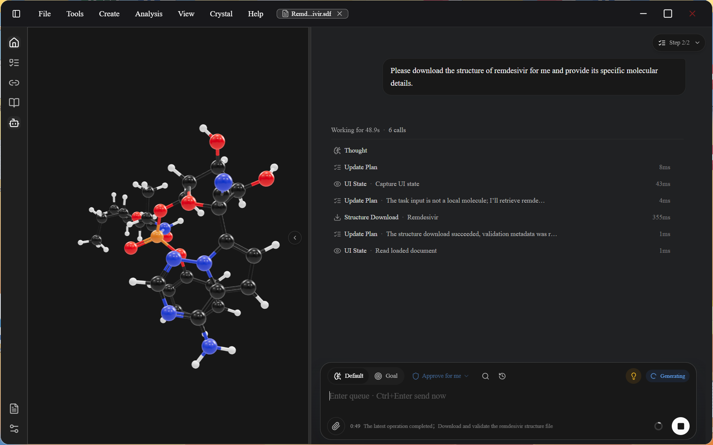
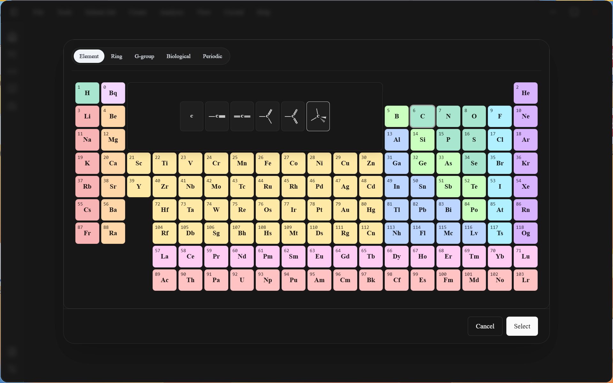
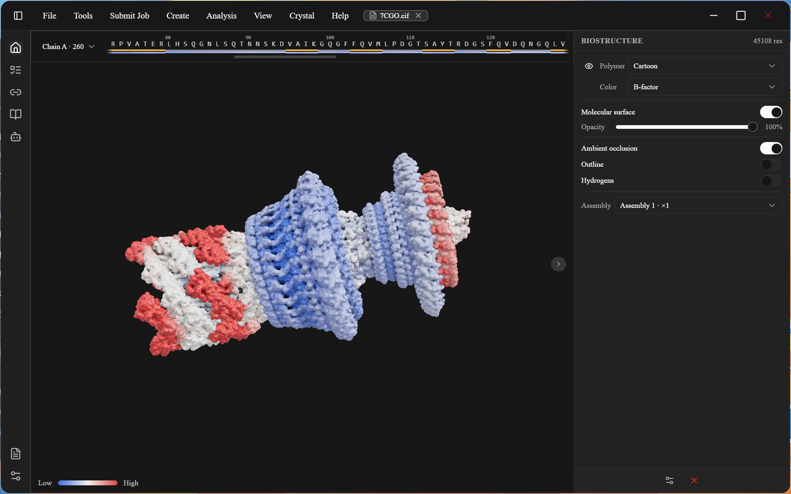
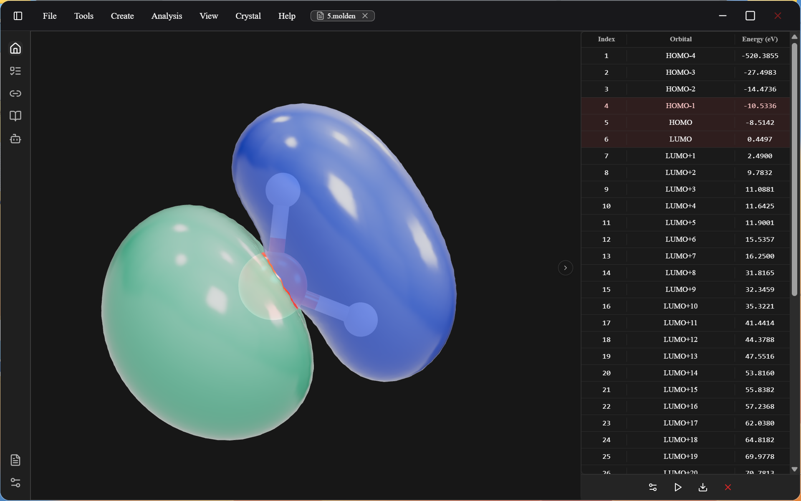

# DeepCurve

<div align="center">

[English](README.md) | **简体中文**

</div>

<p align="center">
  <a href="https://github.com/ruoguli/deepcurve/releases"></a>
  <a href="https://github.com/ruoguli/deepcurve/releases"></a>
  
  <a href="LICENSE"></a>
</p>

<p align="center">
  
</p>

**DeepCurve** 是面向 AI 时代的计算化学桌面中间件，连接研究者、AI Agent、计算软件与科研数据，将结构可视化、计算分析、输入准备和研究工作流整合在一个工作空间中。

<!-- release:version -->
当前版本：**0.2.4**（2026-11-14）。
<!-- /release:version -->

目前仅提供 Windows 和 Linux 版本。项目也具备支持 macOS 的能力，但作者目前没有 macOS 设备进行测试，因此暂未发布 macOS 版本。如需 macOS 版本，可邮件联系作者获取并帮助反馈潜在问题。

<div align="center">

| 入口 | 地址 |
| --- | --- |
| 🌐 社区网站 | [chat.deepcurve.org](https://chat.deepcurve.org) |
| 💻 项目与发布信息 | [github.com/ruoguli/deepcurve](https://github.com/ruoguli/deepcurve) |
| 👤 作者 | Ruogu Li |

</div>

## 📥 下载

<!-- release:download -->
最新版本：**v0.2.4**，点击文件名即可直接下载。

| 🪟 Windows（64 位） | 🐧 Debian / Ubuntu | 🐧 其他 Linux |
| :---: | :---: | :---: |
| [**deepcurve_0.2.4_x64-setup.exe**](https://github.com/ruoguli/deepcurve/releases/download/v0.2.4/deepcurve_0.2.4_x64-setup.exe) | [**deepcurve_0.2.4_amd64.deb**](https://github.com/ruoguli/deepcurve/releases/download/v0.2.4/deepcurve_0.2.4_amd64.deb) | [**deepcurve_0.2.4_amd64.AppImage**](https://github.com/ruoguli/deepcurve/releases/download/v0.2.4/deepcurve_0.2.4_amd64.AppImage) |

🔐 校验文件：[SHA256SUMS.txt](https://github.com/ruoguli/deepcurve/releases/download/v0.2.4/SHA256SUMS.txt) · 更新说明与历史版本：[版本发布页](https://github.com/ruoguli/deepcurve/releases)
<!-- /release:download -->

---

## 🔬 DeepCurve 的用途

计算交给求解器，洞察交给 DeepCurve。支持一键载入结构、输出文件、波函数及网格数据，在 3D 视图中直观呈现实体结构与轨道，并通过多维分析面板深度解析电子结构、化学键、弱相互作用与光谱结果。更融合结构构建、输入编辑与作业管理，实现从“准备、运行”到“分析”的一站式科研闭环。

## 🖼️ 界面截图

<p align="center">
  
  
</p>
<p align="center"><sub>Agent 获取并载入结构</sub> · <sub>分子构建器</sub></p>

<p align="center">
  
  
</p>
<p align="center"><sub>生物大分子结构视图</sub> · <sub>分子轨道视图</sub></p>

## ✨ 主要功能

### 🧬 分子与晶体可视化

- 查看分子、生物大分子和周期性晶体结构，可切换球棍、棍或线框等显示方式。
- 旋转、平移和测量结构；选择原子或连通片段，并编辑原子坐标。
- 使用元素选择器和构件库搭建分子，编辑晶胞参数并查看晶体周期结构。
- 显示米勒指数切面、布里渊区和配位多面体等晶体信息。
- 使用晶体模块中的格点数据工具平移格点数据，或查看超胞中的格点数据。
- 渲染分子轨道、密度和映射曲面，可调节等值面、颜色和材质，并导出适合发表的图像。

### 📈 计算结果

- 解析 ORCA、Gaussian 等程序的输出，浏览几何优化步骤和能量变化，播放振动模式动画。
- 查看与绘制 IR、Raman、UV-Vis、ECD、VCD、NMR 等光谱数据；实际可用内容取决于源文件包含的数据。

### 🌀 波函数分析

波函数分析在后台运行，结果显示在专门的分析面板和三维视图中。方法涵盖化学键、弱相互作用、电荷、电子定域化、激发态、芳香性、磁响应和电子结构等方向。不同方法对输入数据的要求不同；缺少数据时，面板会提示所需内容。

### 🛠️ 结构编辑、导出与计算工作流

- 创建或修改 ORCA、CP2K、Quantum ESPRESSO 等程序的计算输入文件。
- 导出结构、图像、三维模型和网格数据，用于报告或交给其他科学软件处理。
- 导出 `.glb` / `.obj` 三维场景时保留曲面着色信息，方便在 Blender 等软件中继续渲染。
- 在本机 WSL2/Linux、SSH/Linux 主机和 Slurm 集群上提交与管理作业，需要相应的运行环境与账号。
- 配置 Agent 模型服务，并连接用户显式配置的外部 MCP 工具，辅助文件处理和工作流操作。

### 📚 文献与 Agent 工作流

- 在侧边栏的文献库中存放和阅读论文、添加批注并记录想法，也可以让 Agent 与文献库交互。
- 查看上下文使用量、主动压缩 Agent 上下文，并让 Agent 与更多 DeepCurve 界面功能交互。
- 在设置中配置记忆、查看 Token 使用统计，切换模型供应商并探测上游可用模型。
- 通过部分大语言模型的内置基础信息，帮助 Agent 识别模型规格。

## 📂 常见文件格式

DeepCurve 可读取多种计算化学与材料模拟软件的分子和晶体结构、计算输入与输出、轨迹、分子轨道及三维格点数据，支持 ORCA、Gaussian、CP2K、Quantum ESPRESSO、ABACUS、VASP 等程序，也支持 XYZ、PDB、CIF、CUBE 等常见格式。实际可读取的数据取决于文件类型和所选工作流程；部分分析需要同一计算目录中的辅助文件。文件选择器会显示当前操作支持的格式。

## 💿 安装

在 [GitHub Releases](https://github.com/ruoguli/deepcurve/releases) 下载与操作系统对应的安装包：

| 系统 | 安装包 | 说明 |
| --- | --- | --- |
| Windows（64 位） | `*-setup.exe` | 安装到当前用户目录，无需管理员权限；安装向导会根据系统显示语言自动使用中文或英文。DeepCurve 依赖 Microsoft Edge WebView2，Windows 11 已自带；如果系统中没有，安装程序会从微软官方下载，需要联网（下载失败时安装会中止）。 |
| Linux（x86_64） | `.deb` / `.AppImage` | Debian/Ubuntu 系可安装 `.deb`；其他发行版可以给 `.AppImage` 加上可执行权限后直接运行。 |

Debian / Ubuntu 用户可在下载目录运行：

```bash
sudo apt install ./deepcurve_0.2.4_amd64.deb
```

安装后可从应用菜单或通过 `deep-curve` 命令启动。使用 AppImage 时运行：

```bash
chmod +x ./deepcurve_0.2.4_amd64.AppImage
./deepcurve_0.2.4_amd64.AppImage
```

如果某个平台在发布页中没有对应的安装包，说明该版本暂未提供这个平台的构建。

从 v0.2.2 起，新版本可以通过应用内的**检查更新**安装。0.2.0 与 0.2.1 用户需要手动下载安装一次当前版本，后续版本会在应用内提示。

## 🚀 快速上手

1. 启动 DeepCurve，通过“打开”或拖放文件载入结构、计算输出、波函数或网格数据。
2. 在菜单或分析面板中选择需要的操作；如果输入数据不满足要求，面板会提示所需的文件或数据类型。
3. 完成分析后，在结果面板查看数据，并使用相应的导出功能保存结果。

### 🖱️ 三维视图操作

| 操作 | 效果 |
| --- | --- |
| 鼠标左键拖动 | 旋转视图 |
| 鼠标右键拖动 | 平移视图 |
| `Ctrl` + 鼠标左键拖动 | 移动结构中的原子 |
| `Ctrl` + 鼠标右键拖动 | 平移结构 |
| 双击原子 | 选择与其相连的片段 |

## 🤖 Agent、API Key 与外部程序

Agent 需要配置模型服务和 API Key；第三方模型服务可能按其服务条款收费。API Key 保存在系统钥匙串中，不会以明文写入设置文件。Agent 可以联网搜索，既可以使用模型服务商的原生搜索，也可以使用内置的搜索工具。

DeepCurve 不替代 ORCA、Gaussian、CP2K 等计算引擎，也不随应用提供所有可选的外部计算程序。需要调用外部程序或连接远程主机时，请自行准备相应的软件、账号和凭据。外部 MCP 工具需要在设置中显式配置后才会启用。

## 🆕 当前版本更新

<!-- release:notes -->
**v0.2.4** 的主要更新：

- 修复 `.cif` 文件读取问题，开放生物模式，方便查看 DNA、蛋白质等生物结构。
- “键与角度”右侧面板的键类型选择框新增氢键选项。
- 优化 Agent 运行时与前端交互体验。
- 创建模块新增 VASP 输入文件生成，支持 POSCAR、INCAR、KPOINTS，并可从用户提供的赝势库组装 POTCAR。
- 扩展电子密度差（EDD）计算，支持 VASP 密度格点，以及 CP2K、Quantum ESPRESSO（QE）、ABACUS 导出的电子密度 CUBE。波函数与周期格点两种流程均支持多个参考及各参考独立的运算符，直接输出 CUBE，并可自动载入三维视图。
- 优化部分二维绘图界面，支持通过右键菜单导出数据、图片和调整设置，并简化图表布局。
- “关于 → 灵感来源”新增参考实现软件的快速引用。
- 补齐部分方法参考来源，Agent 可按需获取“查看方法出处”中的来源信息。
- 新增“自动移动跨周期表面”，在显示时将跨周期的较小表面碎片拼接到较大片段旁，减少晶胞边界附近的表面截断。

更多变更以应用内的更新说明和[版本发布页](https://github.com/ruoguli/deepcurve/releases)为准。
<!-- /release:notes -->

## 💬 反馈与支持

- 问题反馈与功能建议：[GitHub Issues](https://github.com/ruoguli/deepcurve/issues)
- 使用交流：[chat.deepcurve.org](https://chat.deepcurve.org)

反馈问题时，请尽量附上软件版本、操作系统、复现步骤，以及可以公开的示例文件。

## ⚠️ 使用边界

计算分析结果应结合原始计算设置和科学文献进行检查。DeepCurve 不能保证所有输入文件或分析结果都适用于每一种研究情形，重要结果请用相应的专业程序或独立方法复核。第三方组件及其许可信息可在应用内查看。将本软件用于研究或发表时，请合理引用本软件。作者也建议引用 [Multiwfn](http://sobereva.com/multiwfn/)、[PySCF](https://pyscf.org/) 和 [Mol*](https://molstar.org/) 等项目；DeepCurve 的实现很大程度上借鉴了这些优秀项目的实践。

## 📄 许可

DeepCurve 依据 [DeepCurve 软件使用许可协议](LICENSE)（英文正式文本）发布。第三方组件适用其各自的许可，可在应用内“帮助 → 关于 → 构成DeepCurve的第三方组件”中查看。
